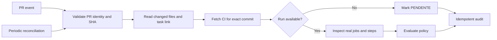

# Pull Request Quality Gate — reference case (n8n)

> **Public-safe educational case.** This is an original, generic representation of the engineering techniques used in a real automation project. It is not a production export and contains no organization-specific rules, endpoints, credential IDs, internal schemas, logs or customer information.

## Problem

A successful CI workflow badge does not necessarily prove that mandatory jobs and steps ran. PRs may also lack traceability to a task, release notes, or CI evidence for the current commit.

## Solution

An **advisory, fail-closed Quality Gate** orchestrated by n8n:



Decisions: **APROVADO** (all required evidence verified), **PENDENTE** (CI running, skipped, unavailable, incomplete or under manual review), **REPROVADO** (proven technical failure or explicit policy violation).

Sonar-like scanners can be recorded separately as *advisory evidence*, avoiding false claims that a scan ran merely because a workflow badge is green.

## Implementation patterns

- Event-driven evaluation plus scheduled reconciliation for missed webhooks.
- Exact SHA matching so stale CI from a previous commit cannot approve a new one.
- Per-branch requirements and checks for real job/step conclusions, rather than top-level badges.
- Separate handling of infrastructure failures vs failed source-code tests.
- Controlled pagination; incomplete API reads produce PENDENTE.
- Deterministic key `repo#PR@commitSHA` for idempotent audit updates.
- Read-only policy: no automatic merges, branch changes or comments.

## Executable example

`evaluate.mjs` is a **generic pure-function example**, intentionally decoupled from n8n, GitHub API credentials and ClickUp credentials. It uses only fictional `TASK-123` metadata.

```bash
node --test cases/pr-quality-gate/evaluate.test.mjs
```

Tests cover approval, missing and queued CI, real technical failures, missing steps, branch requirements, release-note policy, stable audit keys and invalid PR identity.

## Maturity

The operational concept has an active evaluator and periodic reconciliation. An end-to-end observation of a fresh, real PR event is still required; **production behavior is not claimed to be fully homologated** by the synthetic test suite.

## Privacy note

Do not commit exported n8n credentials, production workflow JSON, authorization headers, employee/client data, internal task references, proprietary thresholds, logs or organization-specific repository links. All examples in this folder are independent, fictional and reviewable.

## v1.5 — Resilience and observability

The public reference `observe.mjs` demonstrates safe classification of API failures, including rate limiting, authorization errors, timeouts, network faults and server failures. It outputs only structured metrics: `health`, `apiErrorCount`, `reviewRequired` and per-source states. **It never persists raw error messages, tokens or API payloads.**

Operational techniques: bounded retries for transient failures, error-execution retention within the private platform, periodic reconciliation and idempotent per-commit history. The monitoring model distinguishes unavailable evidence from failed tests and is designed for a future read-only dashboard.

```bash
node --test cases/pr-quality-gate/*.test.mjs
```

This educational example has no network requests, secrets, proprietary rules or organizational identifiers. A real PR end-to-end event still requires independent validation.
